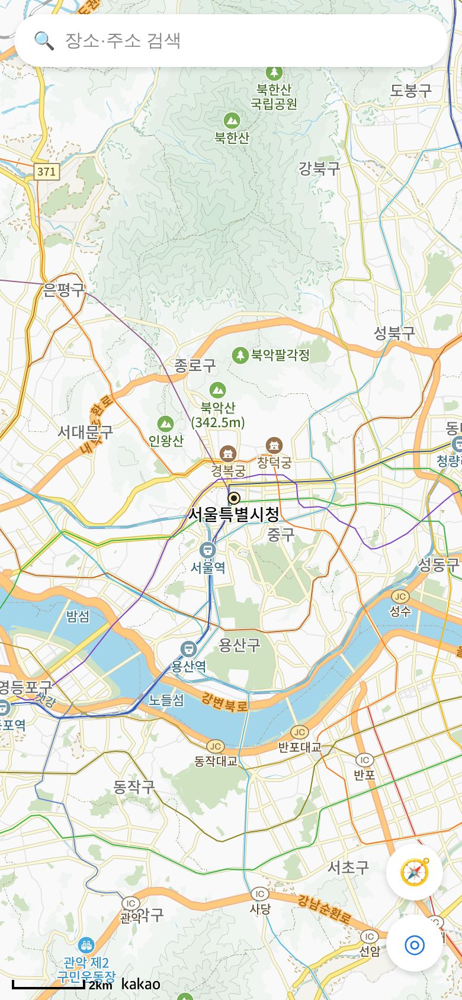
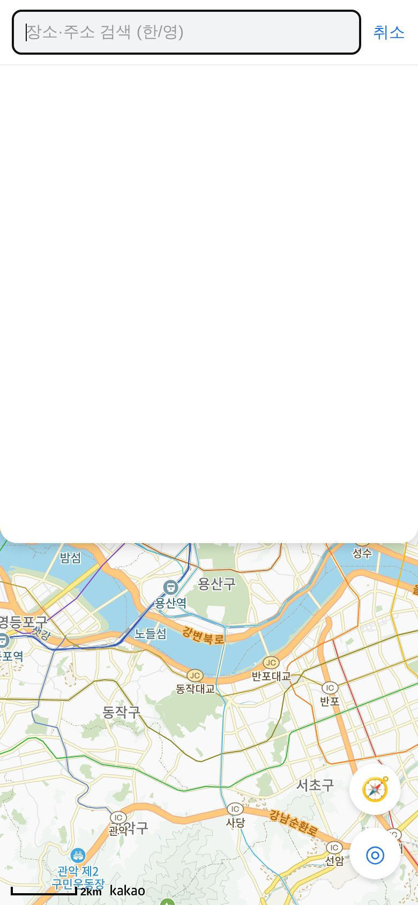
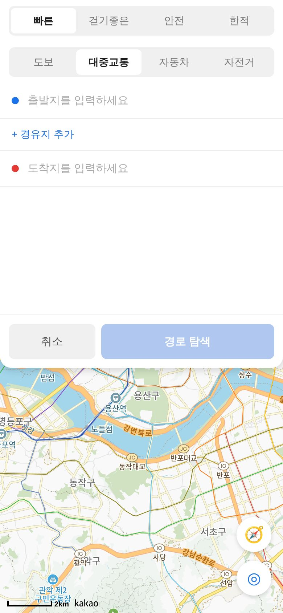
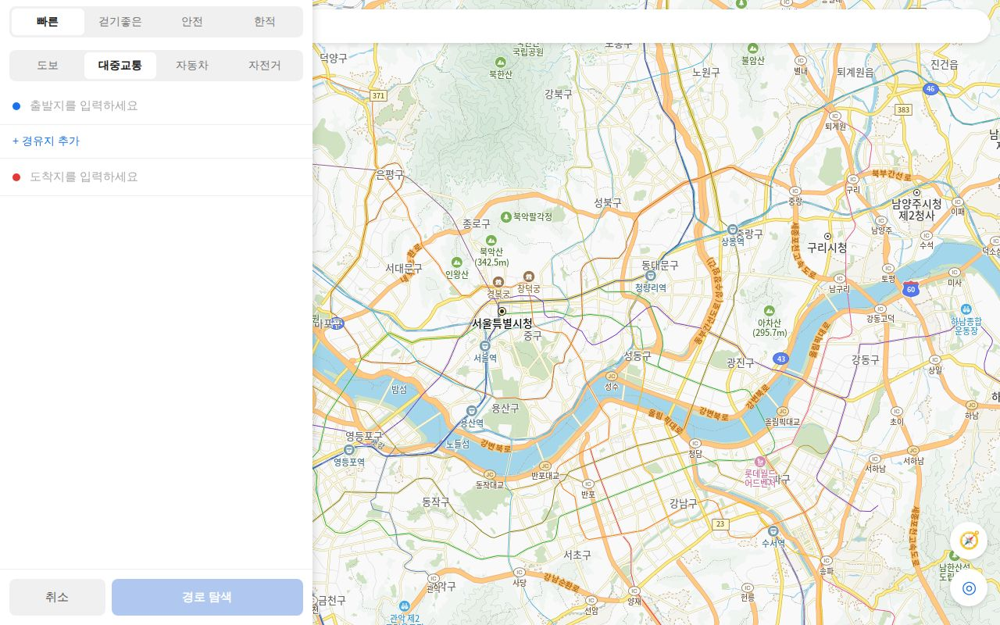

# Wayfinder

카카오맵/구글맵 같은 지도 + 길찾기 앱. **iOS / Android / 웹을 하나의 코드베이스(Expo)로 동시 제공**한다. 한국은 카카오 생태계, 글로벌은 Google/Mapbox 생태계를 결합한 하이브리드 구조로, 장기적으로 자체 라우팅 엔진 기반의 차별화된 경로 옵션(풍경·안전·한적한 경로, +N분 필터)을 제공하는 것이 목표.

**웹 데모: https://wayfinder-awh.pages.dev** (프록시: `https://wayfinder-proxy.hyuckjin.workers.dev`)

  



검색·경로 입력은 지도를 가리지 않는 패널로 뜬다 — 폰은 상단 시트, 넓은 화면(≥768px)은 좌측 패널.

> **상태 (2026-11-18):** Phase 1~5 구현 완료. 웹 배포에서 실데이터로 확인된 것 — 카카오 지도 렌더, 장소 검색(카카오),
> 블로그(네이버·카카오), 도보 경로(TMAP). 아직 미동작 — 대중교통(ODsay가 IP 키라 Workers에서 인증 실패 → 앱 직접 호출로 전환 예정),
> 자전거(Valhalla가 로컬 전용), 자동차·구글(유료 가능 키라 꺼 둠 → "미지원" 안내). GPS·음성·네이티브는 디바이스 QA 필요 —
> **[RELEASE-CHECKLIST.md](./RELEASE-CHECKLIST.md)**.

## 로드맵

| 단계 | 내용 | 결과물 |
|------|------|--------|
| **Phase 1** | Expo 앱 + 지도 표시 + 장소 검색 + 현재 위치 + 장소 상세(리뷰·블로그·거리뷰) | 동작하는 지도 앱 |
| **Phase 2** | A→B→…→Z 길찾기 조회+표시 (도보/대중교통/차/자전거, 전 모드 경유지 지원, 시외 KTX·기차·고속버스 포함) | 경로 조회 |
| **Phase 3** | 도보 턴바이턴 네비게이션 (GPS 추적, 경로 이탈 재탐색) | 따라가는 네비 |
| **Phase 4** | 자체 라우팅 엔진(Valhalla) + 커스텀 경로(풍경·안전·한적) + "+N분" 필터 | 차별화 기능 |
| **Phase 5** | 전 모드 턴바이턴 + 음성 안내 + 실시간 교통 | 풀 네비게이션 |

## 전체 아키텍처

```
┌─────────────────────────────────────────────┐
│  모바일 앱 (Expo / React Native + TypeScript)  │
│                                             │
│  ┌─ UI 레이어 (화면, 검색, 경로 패널)              │
│  ┌─ <MapView> 공통 인터페이스                    │
│  │   ├─ 한국:  Kakao SDK(네이티브) / JS API(웹)  │
│  │   └─ 글로벌: MapLibre(네이티브) / GL JS(웹)    │
│  └─ 데이터 레이어 (장소·경로 서비스 추상화)          │
└──────────────────┬──────────────────────────┘
                   │ HTTPS
┌──────────────────▼──────────────────────────┐
│  백엔드 프록시 (Cloudflare Workers 또는 경량 서버) │
│  - API 키 보관 (클라이언트에 키 노출 금지)          │
│  - 외부 API 호출 중계 + 응답 정규화               │
│  - 캐싱 (장소 정보, 블로그 검색 결과)              │
└──────────────────┬──────────────────────────┘
                   │
   ┌───────────────┼───────────────────┐
   ▼               ▼                   ▼
 카카오/ODsay     네이버 검색          구글/Mapbox
 (한국 지도·경로)  (블로그)            (글로벌 + 리뷰)
                              [Phase 4+: 자체 Valhalla 엔진]
```

### 핵심 설계 원칙

1. **지역 추상화(Region Provider)** — "현재 보는 지역이 한국인가?"를 판단해서 지도 렌더러·검색·라우팅 공급자를 자동 전환한다. 모든 외부 API는 `PlaceService`, `RouteService` 같은 인터페이스 뒤에 숨겨서 UI는 어느 공급자가 응답했는지 모른다. (Phase 4에서 Valhalla 엔진을 끼워 넣을 때 이 인터페이스를 그대로 사용)

2. **백엔드 프록시는 Phase 1부터** — 카카오/구글/네이버 API 키는 클라이언트에 심으면 추출·도용당한다(과금 리스크). 얇은 프록시가 키를 보관하고 앱은 프록시만 호출한다. 초기에는 Cloudflare Workers 무료 티어(일 10만 요청)로 충분.

3. **응답 정규화** — 카카오 장소와 구글 장소는 스키마가 다르다. 프록시에서 공통 `Place`, `Route` 모델로 변환해 내려주면 앱 코드가 단순해지고 공급자 교체가 쉬워진다.

### 장소 정보 소스 (한국)

| 데이터 | 소스 |
|--------|------|
| 기본정보 (이름·주소·전화·카테고리) | 카카오 Local API |
| 평점 + 리뷰 본문 (최대 5개) | 구글 Places API (**선택** — 유료 가능, 키 없으면 구글 탭만 비움) |
| 블로그 글 | 네이버 블로그 검색(NAVER API HUB) + 카카오(Daum) 블로그 검색 API |
| 거리뷰 | 카카오 로드뷰 (SDK 내장) |
| 전체 리뷰 | 카카오맵/네이버 플레이스 딥링크 |

글로벌은 구글 Places(정보+평점+리뷰) + 구글 스트리트뷰로 단순화.

### 경로 공급자

| 모드 | 한국 | 글로벌 |
|------|------|--------|
| 도보 | TMAP 보행자 (+ 커스텀 프로필은 자체 Valhalla) | Google Routes |
| 자전거 | 자체 Valhalla `bicycle` (TMAP엔 자전거 API 없음) | Google Routes |
| 대중교통 | ODsay (시내 leg-chaining, 시외 스티칭) | Google Routes |
| 자동차 | 카카오모빌리티 (**선택** — 상업 이용 시 제휴 필요) | Google Routes (**선택**) |

모드별 키가 없으면: 키가 하나도 없는 개발 환경은 목(mock) 경로, 실 모드 앱에서는 **501 `MODE_UNAVAILABLE` → "이 이동수단 미지원" 안내**(가짜 경로 금지).
카카오맵·네이버 플레이스의 리뷰 본문은 공식 API로 제공되지 않으므로 크롤링하지 않고 딥링크로 연결한다(약관·차단 리스크 회피).

### 기술 스택

| 영역 | 선택 | 이유 |
|------|------|------|
| 앱 | Expo + React Native + TypeScript | JS/React 경험 활용, Mac 없이 iOS 빌드(EAS), 웹에서 확인 가능 |
| 지도 | Kakao Maps SDK(한국) + MapLibre(글로벌) | 하이브리드 — 한국 지도 품질 + 글로벌 커버리지 |
| 백엔드 | Cloudflare Workers (TypeScript) | 무료 티어, 글로벌 엣지, 키 보호 + 캐싱 |
| 상태관리 | Zustand + TanStack Query | 가볍고 API 캐싱에 적합 |
| 빌드/배포 | EAS Build(모바일) + Expo Web→Cloudflare Pages(웹) | Mac/실기기 없이 개발, 웹은 정식 배포 채널 |

## 디렉토리 (Phase 1 모노레포)

```
wayfinder/
├── README.md              # 이 문서 (아키텍처 개요)
├── versions.md            # 핵심 도구체인 버전 핀
├── package.json           # pnpm workspaces 루트
├── pnpm-workspace.yaml    # 워크스페이스 + nodeLinker:hoisted + overrides
├── tsconfig.base.json     # 공통 컴파일러 옵션
├── packages/
│   └── shared/            # @wayfinder/shared — 정규화 타입 + MapView 인터페이스 + 목 픽스처 + region 판정
├── apps/
│   └── mobile/            # @wayfinder/mobile — Expo (RN + web) 앱
├── services/
│   ├── proxy/             # @wayfinder/proxy — Cloudflare Workers + Hono (키 보관·정규화·캐시)
│   └── valhalla/          # 자체 라우팅 엔진 Docker (로컬, 수도권 타일)
├── scripts/
│   ├── secret-scan.sh     # 하드코딩 키 차단 게이트 (CI)
│   ├── env-sync.sh        # key-lib → apps/mobile/.env + services/proxy/.dev.vars (+ --deploy: Workers 시크릿)
│   └── deploy-web.sh      # 프록시(Workers) + 웹(Pages) 배포
└── poc/
    └── map-compare/       # MapLibre(OSM) vs 카카오맵 지도 품질 비교 PoC
```

## 개발 (빌드/테스트 명령)

> 키 0개로 전체 게이트가 통과한다 (데모 모드).

```bash
# Node 22 (.nvmrc), pnpm 11. pnpm 미설치 시: corepack enable && corepack prepare pnpm@latest --activate
pnpm install                          # 워크스페이스 전체 설치 (frozen lockfile은 CI)

pnpm -r typecheck                     # 전 패키지 타입 검사
pnpm -r test                          # 전 패키지 단위/통합 테스트 (Vitest)
pnpm --filter @wayfinder/shared test  # 특정 패키지만

bash scripts/secret-scan.sh           # 하드코딩 키 스캔 (CI 게이트)
pnpm --filter @wayfinder/proxy deploy:dry   # wrangler dry-run (키 불요)
```

> **WSL2(/mnt/d) 주의:** Metro/웹 watch에는 `WATCHPACK_POLLING=true CHOKIDAR_USEPOLLING=true`가 필요하다(inotify 미지원). 심볼릭 링크 취약 → `nodeLinker: hoisted` 사용.

## API 키 · 환경변수

키와 설정 값은 **이 레포 밖** `/mnt/d/Workspace/key-lib`에 둔다 (여러 프로젝트 공용, 레포에는 값 없음).

| 파일 | 내용 |
|------|------|
| `key-lib/keys.env` | 공용 API 키 (범용 이름 `KAKAO_JS_KEY` 등). 발급 링크·절차는 `keys.env.example` |
| `key-lib/wayfinder.env` | 이 프로젝트 설정 — 프록시 URL, `${KAKAO_JS_KEY}` 같은 별칭, 유료 기능 스위치 |

```bash
scripts/env-sync.sh              # → apps/mobile/.env, services/proxy/.dev.vars 생성 (로컬 개발)
cd services/proxy && npx wrangler dev   # 로컬 프록시 http://localhost:8787
```

무료 키만으로 동작한다: 카카오(필수) · 네이버 API HUB · TMAP · ODsay. 구글·카카오모빌리티는 **유료 가능 → 선택**
(비우면 해당 기능만 빠짐, 설계 §11 "국내 전용 구성").

## 배포

```bash
scripts/deploy-web.sh   # 시크릿 업로드 → 프록시 배포 → 웹 빌드(프록시 URL 주입) → Pages 배포
```

- 웹: Cloudflare Pages `wayfinder` → https://wayfinder-awh.pages.dev
- 프록시: Cloudflare Workers `wayfinder-proxy` (KV `wayfinder-cache`), CORS 전체 허용 + rate limit
- 카카오 콘솔: 앱 > 플랫폼 키 > JavaScript 키 > **JavaScript SDK 도메인**에 배포 도메인 등록 필요

